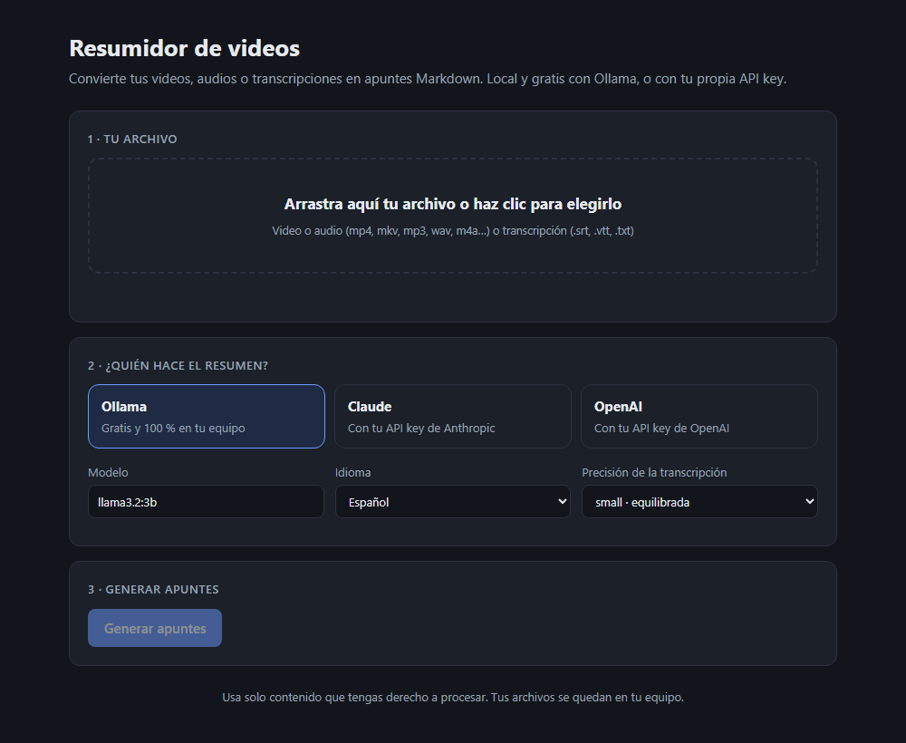

# Resumidor de videos

[](https://github.com/Dio77799/resumidor-videos/actions/workflows/ci.yml)
[](LICENSE)


Convierte tus videos, audios o transcripciones en **apuntes de estudio en Markdown**: resumen general, apuntes clave, notas por sección con marcas de tiempo y preguntas de repaso.

Funciona **100 % local y gratis** con [Ollama](https://ollama.com), o con **tu propia API key** de Claude u OpenAI.



## Por qué
- **Privado:** el video se transcribe en tu equipo con [faster-whisper](https://github.com/SYSTRAN/faster-whisper). Con Ollama, nada sale de tu computadora.
- **Gratis:** sin suscripciones ni servidores. Si prefieres un modelo en la nube, usas tu propia key y pagas solo lo que consumes.
- **Visual:** arrastras el archivo, eliges el proveedor, ves el progreso y descargas los apuntes.
- **Ligero:** la interfaz y el núcleo usan solo la librería estándar de Python.

## Empezar
Necesitas [Python 3.10+](https://www.python.org/downloads/) y, para el modo gratis, [Ollama](https://ollama.com) con un modelo:
```bash
ollama pull llama3.2:3b
```

Luego:
- **Windows:** doble clic en `iniciar.bat`.
- **Linux / macOS:** `./iniciar.sh`

La primera vez crea un entorno virtual e instala las dependencias. Después se abre `http://127.0.0.1:8770` en tu navegador.

<details>
<summary>Instalación manual</summary>

```bash
python -m venv .venv
.venv/Scripts/activate              # Linux/macOS: source .venv/bin/activate
pip install -r requirements.txt     # solo hace falta para audio/video
python app.py
```
</details>

### Por consola
```bash
python resumir.py ejemplos/clase_fotosintesis.srt
python resumir.py mi_clase.mp4 --proveedor anthropic --whisper medium
```

## Cómo funciona
```
archivo (mp4, mkv, mp3, wav, m4a, .srt, .vtt, .txt)
  → transcripción local con faster-whisper   (solo audio/video; .srt/.vtt/.txt se leen directo)
  → resumen por partes con el modelo elegido
  → resumen final: idea central, apuntes clave y preguntas
  → apuntes .md  +  transcripción .srt
```

| Archivo | Qué hace |
|---|---|
| [`app.py`](app.py) + [`web/index.html`](web/index.html) | Interfaz web local |
| [`resumir.py`](resumir.py) | Pipeline completo y línea de comandos |
| [`transcribir.py`](transcribir.py) | Lee subtítulos o transcribe audio/video |
| [`proveedores.py`](proveedores.py) | Ollama, Claude y OpenAI con la misma interfaz |
| [`prompts/`](prompts/) | Plantillas editables de los apuntes |
| [`skills/resumir-video/`](skills/resumir-video/SKILL.md) | Skill para usarlo desde Claude Code |

## Usar tu propia API key
Pégala en la interfaz (se usa para ese resumen y no se guarda) o ponla en un `.env` a partir de [`.env.example`](.env.example).

| Proveedor | Costo | Modelo por defecto |
|---|---|---|
| Ollama | Gratis, local | `llama3.2:3b` |
| Claude | Tu key de Anthropic | `claude-opus-5-5` |
| OpenAI | Tu key de OpenAI | `gpt-5-mini` |

Puedes escribir cualquier otro modelo en el campo *Modelo*.

## Personalizar los apuntes
Edita las plantillas de [`prompts/`](prompts/): `sistema.md` (tono e idioma), `seccion.md` (cada parte) y `final.md` (resumen, apuntes y preguntas). No hace falta tocar código.

## Privacidad
Tus archivos y tus keys se quedan en tu equipo. Lo único que sale es el texto que envías al proveedor en la nube que elijas. La interfaz solo escucha en `127.0.0.1`. Más detalles en [SECURITY.md](SECURITY.md).

## Uso responsable
Usa solo contenido que tengas derecho a procesar: tus clases, tus reuniones o material con licencia libre. Esta herramienta **no descarga** contenido de YouTube, Udemy ni otras plataformas.

El ejemplo [`ejemplos/clase_fotosintesis.srt`](ejemplos/clase_fotosintesis.srt) es material original de dominio público (CC0).

## Contribuir
Las ideas y PRs son bienvenidos: lee [CONTRIBUTING.md](CONTRIBUTING.md).

---

### English
**Resumidor de videos** turns your own videos, audio files or transcripts (.srt/.vtt/.txt) into Markdown study notes: summary, key points, timestamped section notes and review questions. Transcription runs locally with faster-whisper; summaries run locally with Ollama (free) or with your own Claude/OpenAI API key. Pure Python standard library UI, MIT licensed. Run `iniciar.bat` (Windows) or `./iniciar.sh` and open `http://127.0.0.1:8770`.
