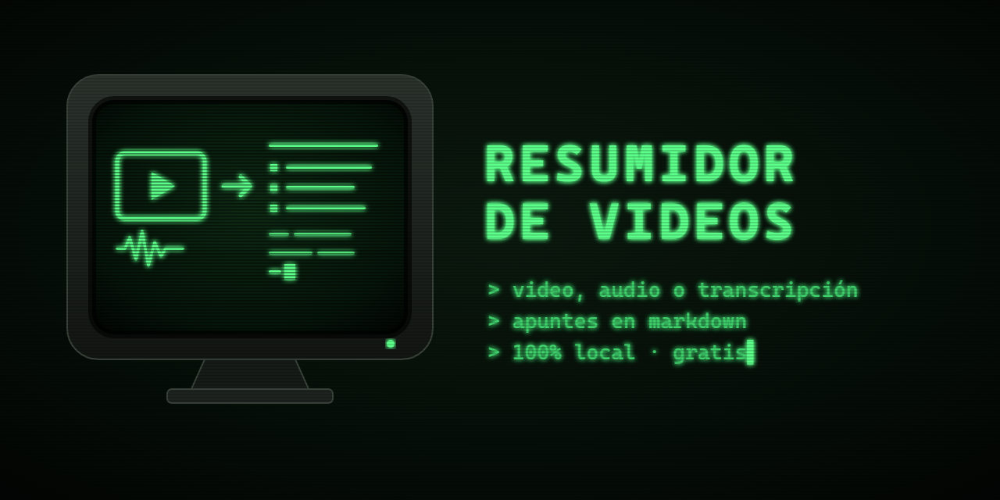

# Resumidor de videos

[](https://github.com/Dio77799/resumidor-videos/actions/workflows/ci.yml)
[](LICENSE)


Convierte tus videos, audios o transcripciones en **apuntes de estudio en Markdown**: resumen general, apuntes clave, notas por sección y preguntas de repaso.

Funciona **100 % local y gratis** con [Ollama](https://ollama.com), o con **tu propia API key** de Claude u OpenAI. Úsalo con su interfaz web o solo desde la terminal.


## Por qué
- **Privado:** el video se transcribe en tu equipo con [faster-whisper](https://github.com/SYSTRAN/faster-whisper). Con Ollama, nada sale de tu computadora.
- **Gratis:** sin suscripciones ni servidores. La app te dice antes de empezar cuánto tardará y cuánta luz gastará (≈ 1 Wh por un video de 1–2 minutos).
- **Sencillo:** arrastras el archivo, eliges quién resume y descargas los apuntes. Temas claro, zen, nocturno y retro (fósforo verde o ámbar).
- **Para cada caso:** modo *clase* (preguntas de repaso), *reunión* (decisiones y tareas) o *charla* (ideas y frases destacadas).
- **No repite trabajo:** si vuelves a resumir el mismo archivo, reutiliza su transcripción y Whisper no gasta nada.
- **Ligero:** sin dependencias obligatorias. La interfaz y el núcleo usan solo la librería estándar de Python.

## Empezar
Necesitas [Python 3.10+](https://www.python.org/downloads/) y, para el modo gratis, [Ollama](https://ollama.com) con un modelo:
```bash
ollama pull llama3.2:3b
```

**Con interfaz (lo más fácil):** descarga el repo y haz doble clic en `iniciar.bat` (Windows) o ejecuta `./iniciar.sh` (Linux/macOS). La primera vez crea un entorno virtual e instala todo; luego se abre `http://127.0.0.1:8770`.

**Solo terminal, como dependencia:** instala únicamente lo que vas a usar.
```bash
pip install "resumidor-videos[audio] @ git+https://github.com/Dio77799/resumidor-videos"
resumidor clase.mp4
```

| Extra | Para qué | Qué instala |
|---|---|---|
| *(ninguno)* | `.srt`, `.vtt`, `.txt` con Ollama | Nada: solo librería estándar |
| `[audio]` | Transcribir audio y video | faster-whisper |
| `[claude]` | Resumir con tu key de Anthropic | anthropic |
| `[openai]` | Resumir con tu key de OpenAI | openai |
| `[todo]` | Todo lo anterior | — |

Se combinan: `pip install "resumidor-videos[audio,claude] @ git+https://..."`.

<details>
<summary>Instalación manual desde el repo</summary>

```bash
git clone https://github.com/Dio77799/resumidor-videos && cd resumidor-videos
python -m venv .venv
.venv/Scripts/activate              # Linux/macOS: source .venv/bin/activate
pip install -e ".[todo]"
resumidor --web
```
</details>

## Uso por terminal
```bash
resumidor ejemplos/clase_fotosintesis.srt
resumidor clase.mp4 --whisper large-v3-turbo --modelo qwen3:8b
resumidor clase.mp4 --proveedor anthropic --salida ~/apuntes
resumidor reunion.m4a --modo reunion  # decisiones, tareas y temas abiertos
resumidor grabaciones/*.mp4            # varios archivos de una vez
resumidor --web                     # abre la interfaz
resumidor --help
```
Los apuntes (`.md`) y la transcripción (`.srt`) se guardan en `./salida`, o en la carpeta que indiques con `--salida`.

## Cómo funciona
```
archivo (mp4, mkv, mp3, wav, m4a, .srt, .vtt, .txt)
  → transcripción local con faster-whisper   (.srt/.vtt/.txt se leen directo)
  → apuntes con el modelo elegido            (videos cortos: una sola llamada; largos: por partes)
  → apuntes .md  +  transcripción .srt
```

| Archivo | Qué hace |
|---|---|
| [`resumidor/resumir.py`](resumidor/resumir.py) | Pipeline y comando `resumidor` |
| [`resumidor/transcribir.py`](resumidor/transcribir.py) | Lee subtítulos o transcribe audio/video |
| [`resumidor/proveedores.py`](resumidor/proveedores.py) | Ollama, Claude y OpenAI con la misma interfaz |
| [`resumidor/energia.py`](resumidor/energia.py) | Estima tiempo y consumo, y se calibra con tu equipo |
| [`resumidor/app.py`](resumidor/app.py) + [`web/`](resumidor/web/index.html) | Interfaz web local |
| [`resumidor/prompts/`](resumidor/prompts/) | Plantillas editables de los apuntes |
| [`skills/resumir-video/`](skills/resumir-video/SKILL.md) | Skill para usarlo desde Claude Code |

## Modelos locales
Desde la interfaz (**Opciones → Modelos para tu equipo**) puedes descargar con un clic modelos mejores que el de serie. Cada uno muestra cuánto tarda y cuánta luz gasta una hora de video en tu equipo. La app usa automáticamente el mejor que tengas instalado.

| Modelo | Tamaño | Para qué |
|---|---|---|
| `qwen3:8b` | 5,2 GB | **Recomendado:** apuntes fieles y detallados (16 GB de RAM) |
| `gemma3:4b` | 3,3 GB | Rápido, mejor español que llama3.2 |
| `llama3.2:3b` | 2 GB | Ligero, para equipos modestos; comete errores en textos largos |
| `gemma3:12b` | 8,1 GB | Apuntes más completos, lento sin tarjeta gráfica |
| `gpt-oss:20b` | 14 GB | La mejor calidad local (24 GB de RAM o más) |

### Ejemplo real
Una clase de 26 minutos (capítulo de *Comentarios reales de los incas*, grabación de dominio público de LibriVox), en una laptop sin tarjeta gráfica:

| | `llama3.2:3b` | `qwen3:8b` |
|---|---|---|
| Tiempo total | 9 min | 17 min |
| Consumo | ≈ 7 Wh | ≈ 13 Wh |
| Calidad | Inventa datos y confunde hechos | Fiel, con nombres y detalles concretos |

👉 [Apuntes generados con `qwen3:8b`, sin editar](ejemplos/comentarios_reales_incas_cap27.md)

## Rendimiento
Medido en una laptop sin tarjeta gráfica (Intel i7-1185G7, 4 núcleos, 32 GB de RAM) con un video de 89 s y `llama3.2:3b`:

| | Transcripción | Apuntes | Total |
|---|---|---|---|
| v0.1 | 22,4 s | 101,9 s (2 llamadas) | 124 s |
| **v0.2** | **15,7 s** | **67,8 s (1 llamada)** | **83 s (−33 %)** |

- Whisper usa búsqueda simple (`beam 1`): 36 % más rápido con 97,4 % de palabras correctas frente al 98,0 % anterior. Puedes volver al modo anterior con `WHISPER_BEAM=5`.
- Si la transcripción cabe entera, los apuntes se escriben en una sola llamada en lugar de dos.

El consumo se estima suponiendo que el equipo gasta ~45 W mientras trabaja; cámbialo con `WATTS_EQUIPO` en `.env`.

## Usar tu propia API key
Pégala en la interfaz (se usa para ese resumen y no se guarda) o ponla en un `.env` a partir de [`.env.example`](.env.example). Modelos por defecto: `claude-opus-5-5` y `gpt-5-mini`; puedes escribir cualquier otro.

**Otros servidores compatibles con OpenAI** (LM Studio, llama.cpp, Groq, OpenRouter…): elige *OpenAI* y define `OPENAI_BASE_URL` en tu `.env`, por ejemplo `http://127.0.0.1:1234/v1` para LM Studio. *Aún no probado: cuéntanos en un issue si te funciona.*

## Personalizar los apuntes
Edita las plantillas de [`resumidor/prompts/`](resumidor/prompts/), o usa tu propia carpeta con `RESUMIDOR_PROMPTS=/ruta/a/mis_prompts`. No hace falta tocar código.

## Privacidad
Tus archivos y tus keys se quedan en tu equipo. Lo único que sale es el texto que envías al proveedor en la nube que elijas. La interfaz solo escucha en `127.0.0.1`. Más detalles en [SECURITY.md](SECURITY.md).

## Uso responsable
Usa solo contenido que tengas derecho a procesar: tus clases, tus reuniones o material con licencia libre. Esta herramienta **no descarga** contenido de YouTube, Udemy ni otras plataformas.

El ejemplo [`ejemplos/clase_fotosintesis.srt`](ejemplos/clase_fotosintesis.srt) es material original de dominio público (CC0).

## Contribuir
Las ideas y PRs son bienvenidos: lee [CONTRIBUTING.md](CONTRIBUTING.md).

---

### English
**Resumidor de videos** turns your own videos, audio files or transcripts (.srt/.vtt/.txt) into Markdown study notes: summary, key points, section notes and review questions. Transcription runs locally with faster-whisper; notes are written locally with Ollama (free) or with your own Claude/OpenAI API key. Use the local web UI (`iniciar.bat` / `./iniciar.sh`) or install it as a terminal tool: `pip install "resumidor-videos[audio] @ git+https://github.com/Dio77799/resumidor-videos"` then `resumidor lecture.mp4`. Zero required dependencies, MIT licensed.
